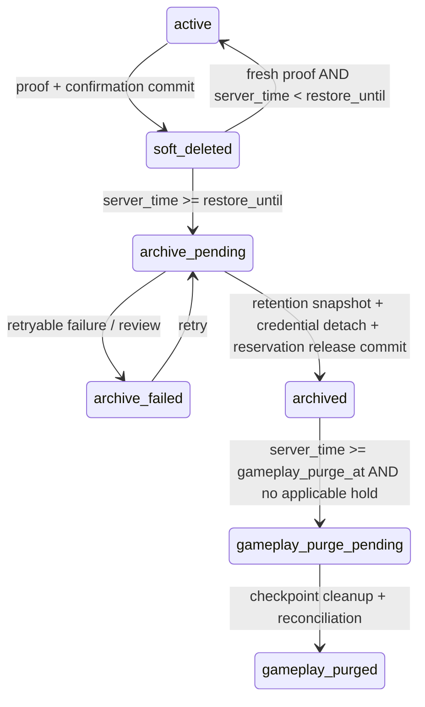

# C232 v3 — kỹ thuật vòng đời archive tài khoản

Version 1.1 · 2026-11-02 · IMPLEMENTED_LOCAL / TESTED_SCOPED; acceptance production/pháp lý còn mở.

Business policy chuẩn: [B6 archive policy](../../client/docs/standards/g2-registration/implementation/retention/B6/archive-policy.md) từ workspace. Contract C232 v3.0.1, runtime/service v3 core đã chạy local với schema 2/config 69. Không dùng worker v2 rollback; production chưa triển khai. Các yêu cầu mở về retention expiry, backup, key rotation/RBAC vẫn cần nghiệm thu riêng.

## State machine và bất biến



Không transition từ archived/purge về active. Thiết lập recovery_allowed=false từ deadline là điều kiện server, không đợi cron. Job cancelled giữ lịch sử; yêu cầu mới là job mới. Chỉ job soft_deleted còn hạn được restore. Receipt không cấp quyền mutation.

Tách account lifecycle khỏi status của deletion request và status của từng dataset job; không dùng completed cho ý nghĩa vừa archive, vừa gameplay purge, vừa tất cả dữ liệu đã biến mất. Stable user_id cũ là khóa phạm vi; không truy tìm đối tượng xóa qua email/phone. User mới không kế thừa ownership cũ.

## Schema và mapping triển khai

| Thành phần | Trường/chức năng cần bổ sung |
|---|---|
| account lifecycle | account_id, state, lifecycle_revision, request_id, soft_deleted_at, restore_until, archived_at, gameplay_purge_at, gameplay_purged_at, service_stopped_at + trigger_source, policy_revision/hash/snapshot |
| archive manifest | request_id, subject/alias manifest, dataset/version, ciphertext reference, encryption_key_id, retain_until, integrity digest, committed_at; không FK cascade từ user/login |
| identity reservation | namespace + canonical HMAC identifier, owner_id, reservation_generation, state/released_at; guardian quota theo từng profile owner |
| dataset job | unique(request_id,dataset,action), status, checkpoint, lease_owner/lease_until, attempts/next_attempt_at, before/after counts, policy snapshot |
| hold | subject/request/dataset/action scope, reason code, actor, placed_at/released_at, audit references; không đồng nhất hold dữ liệu với reservation |
| minimal user | user_id và lifecycle/audit references cần thiết; email/password/provider bindings không còn là credentials sau archive |

Không mặc định tái sử dụng mọi table v2.0: cần migration và inventory FK/unique trước. Cột/profile PII retained phải tách khỏi query runtime, bootstrap, backup export công khai và quota. Kho archive không có API public read.

### Mapping code hiện tại

Lifecycle và subject_manifest nằm trong account_identity_deletions; state request cũng là lifecycle state cho workflow này, cùng audit riêng. Không tạo thêm bảng reservation: canonical users/email/provider và compliance_activation/profile giữ chỗ khi soft-deleted; archive transaction detach/xóa các binding này rồi ghi identity_released_at. compliance_phone_locks chỉ là khóa CAS, không là quyền sở hữu số; không xóa bucket chung của phụ huynh.

Không có saga qua native API: archive.js là native-schema adapter PostgreSQL cho Nakama3.24.2, kiểm tra danh sách users columns chính xác rồi chạy toàn bộ snapshot mã hóa, credential/device detach, profile removal và final archive commit trong MỘT transaction. Native user không bị delete. Schema lạ hoặc SQL lỗi rollback/fail-closed. Đây là quyết định thực thi thay cho phương án saga khi dùng API ở phần thiết kế; nâng Nakama phải audit adapter và chạy integration lại.

Checkpoint dataset là một account+alias transaction trong account_gameplay_cleanup_v1, có audit counts/reconciliation; không có bảng dataset-job riêng. Job lock/SKIP LOCKED serialize worker replicas; statement_timeout theo worker.lease_seconds giới hạn từng câu lệnh, không tuyên bố là lease job ngoài DB transaction. next_run_at persisted trong account_archive_worker_state; batch đầy được drain tiếp, lỗi backoff/max attempts, rồi manual/gameplay review. ARCH-09 chưa kiểm chứng mọi tình huống process kill/backup.

Raw native API read/list/write/delete storage, GetAccount, UpdateAccount và provider link/unlink đã có lifecycle/generation guard; không chỉ dựa vào game RPC. Registrations phải là lời gọi initializer trực tiếp vì runtime Nakama trích function key tĩnh; dynamic method registration không dùng được. [API hooks chính thức](https://heroiclabs.com/docs/nakama/server-framework/introduction/hooks/). Trên stack3.24.2 đã kiểm thử old-token storage/update/custom-link bị từ chối, native write của active new user vẫn hoạt động.

## Chuyển archive và ràng buộc Nakama

1. Claim job bằng lease, khóa/CAS request và lifecycle revision; xác nhận đã hết hạn, không còn active mutation và không có lifecycle merge/reset xung đột.
2. Chốt manifest owner + alias + dataset; tạo archive mã hóa có kiểm chứng. Không giải phóng danh tính trước khi có bản lưu bền vững.
3. Stage thu hồi toàn bộ credential Native Nakama: email/password, Google và các provider/custom/device bindings thực tế đã kiểm kê. Không gọi accountDeleteId nếu thao tác đó cascade xóa user tối thiểu/billing/gameplay đang cần giữ.
4. Finalize trong transaction: kiểm chứng detach đã hoàn tất, archive tồn tại, owner/revision chưa đổi; mark archived, ghi archived_at và gameplay_purge_at, release đúng reservation/quota owner. Khi native API không cùng transaction với PG, dùng saga checkpoint: luôn giữ deleting gate và reservation tới finalize, retry idempotent sau crash. Không hứa native API và SQL transaction nguyên tử nếu chưa có cơ chế đó.
5. Mọi đường native auth/create/link, đổi email/phone, OTP, restore, server lifecycle và callback phải tuân cùng tập trạng thái. Đăng nhập trực tiếp bằng ID không được bypass archived gate. Sau finalize không được rollback bằng cách bind lại credential đã có thể thuộc user mới.

Retention snapshot thành công nhưng detach thất bại: archive_pending/failed, không release. Detach thành công nhưng finalize lỗi: vẫn pending, không restore hoặc đăng ký lại bằng reservation đó; worker tiếp tục checkpoint. Cần metric/SLA/manual resolution để không giữ chỗ vô hạn do job lỗi. Client chỉ nhận committed state.

## Cấu hình thực thi — system.account_deletion schema2

Seed mặc định tắt dưới đây, đồng bộ server/data/account_deletion_policy.json. Local publish riêng thành revision local-archive-v3-1/key ID local-retention-v1. Không dùng như fallback khi config thiếu:

```json
{
  "schema_version": 2,
  "revision": "archive-v3-initial",
  "enabled": false,
  "timezone": "Asia/Ho_Chi_Minh",
  "soft_delete_days": 14,
  "restore_before_deadline_only": true,
  "identity_release_event": "archive_committed",
  "minimal_user_mode": "retained_tombstone",
  "archive_transition_enabled": false,
  "gameplay_purge_enabled": false,
  "retention_key_id": "configure-before-enabling",
  "notice_template_revision": "archive-1",
  "worker": {
    "scan_interval_seconds": 86400,
    "batch_size": 50,
    "lease_seconds": 120,
    "retry_backoff_seconds": 60,
    "max_attempts": 12
  },
  "reauth": {
    "google_max_age_seconds": 300,
    "email_link_ttl_seconds": 900
  },
  "datasets": [
    {
      "id": "gameplay",
      "processor": "account_gameplay_cleanup_v1",
      "trigger": "archive_committed",
      "calendar_months": 3
    },
    {
      "id": "player_identity",
      "processor": "protected_identity_archive_v1",
      "trigger": "confirmed_deletion",
      "calendar_months": 6
    },
    {
      "id": "billing_transaction",
      "mode": "retain_review_required"
    },
    {
      "id": "minimal_user",
      "mode": "retain_review_required"
    }
  ]
}
```

account_gameplay_cleanup_v1 và protected_identity_archive_v1 đã thực thi cleanup gameplay và tạo archive mã hóa. Player identity dùng trigger confirmed_deletion/soft_deleted_at, baseline6 tháng: cần mapping pháp lý được duyệt; chưa có processor expiry archive. Billing/minimal_user retain_review_required là giữ nguyên để review, không có auto purge hoặc căn cứ giữ vô hạn. Không nhận SQL/script tùy ý từ config. Restore/release là bất biến, không cho toggle release rồi restore. Thời hạn gameplay chỉ lấy từ dataset gameplay.calendar_months. Cấu hình duration/worker/proof có validator và snapshot; đăng ký email mới vẫn có TTL15 phút riêng theo C232 registration, không dùng delete policy tắt để chặn đăng ký.

Deadline và snapshot được ghi khi nhận yêu cầu; archived_at chỉ ghi một lần khi finalize. Dùng thời gian server, UTC lưu trữ và calendar arithmetic tại timezone đã snapshot; không tính tháng =30 ngày. Lần scan kế tiếp xử lý due jobs, không thay deadline vì retry. Schema thiếu/sai/không tương thích fail-closed; client vẫn được truy cập status/hỗ trợ. Secret chỉ ở secret store/env; policy chỉ giữ key ID.

## Gameplay cleanup và tài chính

Lập dataset inventory có table/storage collection/key pattern, owner/FK, scope alias/realm, action và expected counts trước code. Chỉ xóa gameplay; giữ user tối thiểu và finance records cần thiết. Không sử dụng nguyên hàm account_identity_cleanup v2.0 vì hàm đó còn xóa/minimize dữ liệu identity, archive snapshot và tài chính theo flow cũ; phải tách processor.

Mỗi batch cleanup idempotent, claim bằng lease/CAS; checkpoint và outbox/audit commit cùng thay đổi dataset khi có thể. Không cascade từ user; không chuyển billing sang user mới vì trùng thông tin. Transaction/purchase token chống replay, refund/chargeback/subscription event gắn stable subject/order cũ. Callback cũ bị chặn grant gameplay và được ghi đối soát; không tự bỏ qua nghĩa vụ xử lý tài chính.

API status đích bổ sung lifecycle_state, restore_until, restore_eligible, archived_at, identity_released, gameplay_purge_at, gameplay_purged_at, processing_state, message_revision. Giá trị chưa commit trả null/false đúng thực tế. Không trả email/phone/profile/archive payload. Giữ tương thích receipt v2, không đổi completed lịch sử thành gameplay_purged nếu thiếu evidence.

## Quyền truy cập đích và điều kiện vận hành

| Chủ thể | Quyền dự kiến | Giới hạn |
|---|---|---|
| Người chơi | Xem receipt của mình; yêu cầu restore có proof trước hạn | Không đọc archive, đặt hold hoặc kéo dài deadline |
| Hỗ trợ | Tra cứu trạng thái theo quy trình xác minh | Không tự bind credential, restore archived hoặc chuyển tài sản |
| Retention operator | Chạy dry-run, retry checkpoint, thực thi policy đã duyệt | Không sửa trực tiếp owner/reservation/deadline để bỏ gate |
| Người duyệt hold/policy | Đặt/gỡ hold có scope, phê duyệt thay đổi và migration | Audit actor/reason/diff/time; không biến hold thành quyền restore |
| Billing operator | Đối soát hồ sơ giao dịch tối thiểu cần thiết | Không đọc toàn bộ hồ sơ giám hộ hoặc cấp gameplay vì email trùng |
| Quản lý khóa | Cấp/rotate/recover key theo key ID và quy trình được duyệt | Không đưa khóa vào DB config, logs, client hoặc evidence |

Đây là ma trận quyền yêu cầu, chưa phải RBAC đã triển khai. Trước khi bật production phải chốt lịch lưu user tối thiểu, billing/transaction và trigger hợp lệ; review_required trong JSON mẫu không phải lý do giữ vô hạn. Dataset chưa có policy được duyệt không được tự purge. Evidence truy cập hợp lệ/trái phép và audit phải được thu trong ARCH-06.

## Migration, backup và acceptance

Job v2.0 soft_deleted: chỉ migrate sau policy diff và notice phù hợp, giữ restore_until; không tự bật purge processor cũ. Job v2.0 completed đã mất gameplay không được báo còn3 tháng hoặc có thể khôi phục. Job legacy/partial archive chuyển review có inventory, không suy completed từ user bị disable. Có dry-run counts, checkpoint và audit cho từng batch.

Backup restore phải phục hồi ledger/reservation generation/hold và archive-key references hiện hành trước mở auth. Không bind lại credential cũ hoặc tái tạo gameplay từ snapshot cũ của account đã archive/purge. Kiểm chứng bằng tài khoản mới dùng lại email/phone và người giám hộ có nhiều con. Policy được rollback chỉ khi không phá vỡ nghĩa vụ và quyền sở hữu đã commit; không chạy worker v2.0 để rollback workflow v3.

Acceptance theo checklist tại B6 archive-policy, evidence thư mục riêng phase-v3; test migration v2/legacy, crash tại mỗi saga checkpoint, concurrency, deadline, calendar boundaries, số dùng chung, payment callbacks, key/hold, backup restore và UI/email/Android. Tài liệu pháp lý chỉ mô tả chức năng đã được nghiệm thu; không dùng tài liệu thiết kế này làm kết quả vận hành production.

## Inventory processor đã thực thi

| Nhóm | Archive | Gameplay purge |
|---|---|---|
| users + user_device | Clear email/password/all provider IDs, tombstone username/PII metadata, disable user; remove device bindings | Giữ user ID và structural fields; clear game wallet |
| compliance_activation + verification/challenges | Encrypt profile owner+aliases; remove account-owned activation rows, verification và proof; không đụng rate/phone locks chung | Không có bước release lần hai |
| account-owned storage | Giữ game collections bị cô lập | Delete theo frozen subject_manifest; system-owned audit/replay rows không thuộc predicate |
| player_characters/preferences, weekly, sweep claims, VIP credits, entitlements, daily reward claims/fragments, compliance_playtime, player_health_activity, notifications/leaderboard | Giữ tới hạn; các gate không cấp dữ liệu/quyền chơi | Xóa đúng account/alias, audit count và đối soát |
| link/lifecycle gameplay snapshots | Không dùng để restore archived account | Xóa link snapshots/tasks/intents và redact lifecycle manifest storage/characters/weekly; giữ operational audit |
| purchase orders/purchases, receipt reservations, native purchase/subscription, payment_financial_records/snapshots/attempts, wallet ledger, financial inbox/ad-reward records | Giữ stable old owner, không tự gắn sang user mới | Không sửa/xóa, kể cả provider raw payload; cần retention/minimization tài chính riêng |
| archive/audit/holds/tombstone | Mã hóa, key ID/digest và actor/case riêng; không public read | Giữ nguyên; expiry/key rotation/RBAC production/backup còn mở |

Native social/group relations không có processor purge được nghiệm thu trong đợt này; phải inventory riêng trước khi bật các tính năng đó. Không tuyên bố mọi bảng chứa user ID đều đã được xóa.

Local build/package tests13 integration-enabled, static server/client và Godot/browser fixture đều có evidence phase-v3. Deployment local không xóa user thật; manifest ghi aggregate jobs/config/health và source hash. Tài liệu system/runbook/dossier cập nhật; B6 vẫn IN_PROGRESS, không ACCEPTED production/legal.
