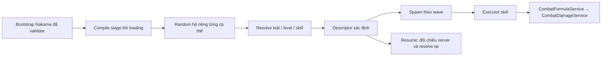

# Workflow tạo một arc với pipeline C239/C240

Tài liệu này mô tả luồng tạo hoặc migrate một arc: **catalog loài → atlas skill → stage/wave → compile khi loading → spawn → damage chung → kiểm thử → nạp local → chụp UI → balance**.

Các lệnh bên dưới chạy từ workspace chứa hai repository `client/` và `server/`, trừ khi có chỉ dẫn khác. Gameplay lấy cấu hình từ Nakama qua bootstrap đã đăng nhập; JSON trong `server/data/` là dữ liệu authoring/seed, không phải fallback để client chơi offline.

## 1. Xác định arc và phạm vi

Ghi rõ ID, thứ tự hiển thị, danh sách stage, background, roster creep/boss và chính sách hệ. **Không suy thứ tự arc từ tên ID.** Ví dụ Arc 1 đang dùng `arc_2`, với `stage_flame_frontier` và `stage_2_02`–`stage_2_10`.

Nếu migrate arc đang có, lưu bản trước thay đổi và đối chiếu số wave, số lượng quái, lịch spawn, formation, EXP, loot, unlock và recommended power. Chỉ đổi những trường nằm trong phạm vi migration.

Cập nhật contract C239 hoặc contract của arc, changelog, `docs/contracts/REGISTRY.json` và `docs/INDEX.md` trước khi sửa implementation. Khi thay đổi giao diện, phải có ảnh gameplay sau thay đổi.

Với **arc mới hoàn toàn**, cần đăng ký đủ ba lớp dữ liệu, không chỉ tạo wave:

| Dữ liệu | Nội dung cần tạo |
|---|---|
| Arc — `server/data/arcs.json` | ID duy nhất, `order`, tên/mô tả, hệ chủ đạo nếu có, `stage_ids`, điều kiện mở và hệ số presentation nếu dùng |
| Stage — `server/data/stages.json` hoặc file authoring migration được installer sử dụng | ID/arc ID, tên, thứ tự/level, background/music, boss flag, loot/unlock, stage rules v2 và wave entries |
| Difficulty — `server/data/stage_levels.json` | Rows liên kết stage cho `normal`, `epic`, `legend`; stamina, phần thưởng, loot, unlock và recommended power |

Nếu chọn file migration riêng làm nguồn authoring, phải có bước materialize/installer rõ ràng từ file đó vào các bảng server; tạo JSON chưa đồng nghĩa game đã đọc được arc. Với arc mới, installer/seed phải **tạo row arc, stage và difficulty trước**, rồi tạo wave liên kết. Installer Arc 1 hiện chỉ cập nhật các row đã tồn tại nên không làm thay phần này.

Đăng ký background, icon và animation trong presentation catalog/AtlasRegistry. Kiểm tra luồng chọn stage, điều kiện mở arc kế tiếp, feature admission và bắt đầu/kết thúc run ở cả client/server; không mặc định mọi registry hoặc luật unlock đều tự nhận một ID mới. Hệ số visual chỉ đổi kích thước hiển thị, không được dùng như hệ số combat.

## 2. Tạo catalog loài

Mỗi loài khai báo base attributes và growth riêng. Không suy chỉ số từ level/base hero hoặc power tham chiếu của arc.

```text
Stat(L) = base_attribute + (L - 1) × growth_per_level
```

Ví dụ một loài tanker:

```json
{
  "stone_guard": {
    "visual_definition_id": "lava_brute",
    "role": "tank",
    "base_attributes": {
      "hp": 84,
      "atk": 11.4,
      "def": 6.3,
      "move_speed": 34,
      "attack_speed": 0.45,
      "attack_range": 68,
      "crit_rate": 0,
      "crit_damage": 1.5
    },
    "growth_per_level": {
      "hp": 18,
      "atk": 1.4,
      "def": 1.2,
      "move_speed": 0,
      "attack_speed": 0,
      "attack_range": 0
    },
    "reward": {"exp": 1, "gold": 22}
  }
}
```

`visual_definition_id` phải tồn tại trong enemy catalog và cung cấp presentation. Stat, reward và skill combat của v2 được dựng từ catalog/stage mới. Đăng ký asset qua `AtlasRegistry`, không load texture rải rác trong gameplay.

Loài **không chứa element cố định hoặc danh sách skill được phép học**. Stage quyết định hệ và skill trang bị. Tanker ưu tiên growth HP/DEF, ranger ưu tiên growth ATK; thông số từng loài có thể chỉnh độc lập sau này.

Catalog runtime nằm tại `progression.enemy_framework.species`. Khi thêm file authoring cho arc mới, phải nối species của file đó vào `buildFramework()` trong `server/tools/enemy_framework_catalog.cjs` để seed và runtime dùng cùng dữ liệu.

## 3. Chọn hoặc bổ sung skill trong atlas chung

Nguồn authoring cho skill creep/boss native là `server/data/creep_boss_skill_atlas.json`. Dữ liệu được đưa vào `progression.enemy_framework.skill_atlas`. Tra cứu skill có sẵn trước khi thêm; cùng hành vi và cùng hệ dùng chung ID.

| Trường | Ý nghĩa |
|---|---|
| `id` | ID atlas ổn định để stage tham chiếu |
| `element` | Hệ cố định của skill; không lấy theo caster lúc gây damage |
| `kind` | `native`, hoặc executor chung `direct`, `area`, `max_hp` |
| `executor` | Với native: `enemy_cast` hoặc `enemy_trait` |
| `levels` | Dữ liệu từng level; chỉ dùng level thật sự tồn tại |
| `payload` | Với native: type, hệ số, cooldown, báo chiêu, hiệu ứng, hình học… |

Skill có damage dùng **ATK hiện tại của caster × hệ số level skill**. Các chiêu legacy có executor riêng tiếp tục giữ windup, projectile, vùng đánh, trigger và hiệu ứng đặc thù. Không đổi chiêu băng thành Hỏa chỉ vì boss đổi hệ.

Điều kiện học/trang bị lấy từ hệ: skill vô hệ dùng được cho mọi actor; skill có hệ phải thuộc tập hệ của actor. Stage trang bị một tập skill cụ thể, không tự bật mọi skill có thể học.

Khi thêm một loại hành vi mới, cần bổ sung executor và validator tương ứng ở client/server, cùng kiểm thử thực thi. Atlas hiện tái sử dụng dữ liệu native qua adapter của `Enemy`; việc hero/pet thực thi các payload đặc thù này cần adapter phù hợp, không tự có chỉ bằng thêm ID.

## 4. Khai báo stage, wave và loadout

Stage giữ metadata thông thường như ID, arc ID, tên, background, loot và unlock. Bật pipeline mới bằng:

```json
{
  "enemy_framework_version": 2,
  "campaign_arc_order": 6
}
```

Đây là nội dung của `stage.stage_rules`. `WaveManager` còn xác định lại thứ tự từ arc catalog khi tải trận để áp dụng giới hạn đa hệ.

Ví dụ entry dùng skill atlas đã tồn tại:

```json
{
  "species_id": "stone_guard",
  "level": 10,
  "elements": ["fire"],
  "count": 4,
  "interval": 1.2,
  "start_delay": 0,
  "boss": false,
  "spawn_role": "tank",
  "formation_lead_seconds": 1.5,
  "exp": 6,
  "skills": [
    {
      "skill_id": "native_fire_claw_fire_c1e758621234870e",
      "level": 1,
      "slot": "attack_skill"
    }
  ],
  "difficulty_overrides": {
    "epic": {"level": 13},
    "legend": {"level": 16}
  }
}
```

Đây là mẫu cấu trúc, không phải yêu cầu mọi tanker phải dùng chiêu này. Chọn executor/skill phù hợp vai trò và tầm đánh của loài.

| Slot native | Công dụng |
|---|---|
| `attack_skill` | Đòn tấn công chính; tối đa một payload |
| `boss_skills` | Chiêu theo cooldown, trigger hoặc passive của boss |
| `generic_skills` | Trait như shield, haste, defense buff… |

**Phải khai báo đòn chính thực sự.** Với v2, `attack_skill` rỗng không tự sinh một basic attack ẩn. Có thể trang bị `shared_neutral_basic` ở `attack_skill` để có đòn basic vô hệ. Skill `direct`/`area` của executor chung không cần slot native.

Boss cần cờ `boss: true` tại entry và loadout đầy đủ. Giữ skill level, cooldown, điều kiện HP, passive và chiêu hồi sinh/biến thân theo thiết kế. Skill basic được phản chiếu trong danh sách boss chỉ khi có `basic: true` và payload giống hệt; runtime không cast nó thêm lần nữa từ danh sách chiêu đặc biệt.

Difficulty override thay level quái hoặc skill/loadout. Override được merge ở cấp entry, nên khi thay `skills` hoặc `skills_by_element`, hãy cung cấp nguyên danh sách/map cần dùng. Không chồng thêm `hp_mul`, `atk_mul`, `def_mul`, `modifiers` hoặc stat override legacy vào entry v2.

`entry.exp` là EXP mỗi cá thể; tổng EXP wave bằng `count × exp`. Server đã hỗ trợ trường này khi tính trần EXP. Gold lấy từ reward loài; loot và phần thưởng stage tiếp tục dùng luồng server hiện có.

## 5. Cấu hình hệ và random

### Arc 1–5: chỉ một hệ

Giữ tỷ lệ đã được duyệt cho arc. Không bật song hệ ở các arc này. Với Arc 1 hiện tại, logic cũ là 70% theo hệ arc và 30% giữ hệ gốc loài; vì cả hai đều Hỏa nên kết quả thực tế là Hỏa đơn hệ. Không diễn giải thành 70% Hỏa + 7,5% mỗi hệ khác khi chưa có thay đổi thiết kế được duyệt.

### Từ Arc 6: có thể cấu hình song hệ

Thay `elements` bằng `random_elements`; không khai báo cả hai cùng lúc:

```json
{
  "pool": ["metal", "water", "wood", "fire", "earth"],
  "weights": {"metal": 1, "water": 1, "wood": 1, "fire": 1, "earth": 1},
  "count": 1,
  "second_element_chance": 0.1
}
```

Đây là nội dung của `entry.random_elements`. Mỗi cá thể chọn một hệ chính theo trọng số; độc lập có 10% cơ hội chọn thêm một hệ khác, không trùng. 10% là xác suất mỗi cá thể, không phải quota đúng 10% trong từng wave/trận. Chỉ những hệ trong `pool` cần có trọng số dương hợp lệ; nếu bỏ `weights`, trọng số mặc định là 1.

Khi hệ thay đổi, dùng `skills_by_element` chứa loadout cho **từng hệ chính có thể được chọn**. Mỗi giá trị là một mảng tham chiếu skill cùng cấu trúc với `skills`. Compiler chọn nhánh tương ứng, kiểm tra tính tương thích và lưu skill đã resolve vào descriptor. `skills_by_element` không phải danh sách cho phép theo loài.

Ví dụ cách tạo map khi authoring:

```javascript
const skillsByElement = Object.fromEntries(elements.map(element => [element, [
  {skill_id: selectedSkillIdByElement[element], level: 1, slot: 'attack_skill'},
  ...neutralTraits
]]));
```

`selectedSkillIdByElement` phải được chọn từ atlas theo hệ cố định và hành vi phù hợp. Không clone rồi đổi trường element của cùng một chiêu để lấp các nhánh. Với boss đa hệ cố định, khai báo `elements` và danh sách skill tương thích trực tiếp.

## 6. Compile, spawn, damage và resume



- `EnemyFramework.compile_stage()` validate catalog và cả các nhánh loadout, mở rộng `count` thành descriptor cá thể, tính growth và resolve skill trước trận. Node được spawn theo wave, không tạo sẵn toàn bộ stage.
- RNG random hệ là RNG riêng có seed. Cùng cấu hình và seed phải tạo cùng descriptor, không làm lệch RNG combat chung.
- Projectile, area và DoT giữ hệ của skill/component lúc tạo. C240 tính crit, khắc hệ, DEF và giảm damage đúng một lần. Actor tiếp tục quản lý dodge, immunity, shield, HP và death.
- Resume đối chiếu descriptor với stage compile từ snapshot server hiện tại; không tin stat, modifier hoặc payload skill tùy ý trong save. Đây không phải quyền chơi offline khi mất kết nối.
- Object pool phải xóa mask, cooldown và trạng thái cũ; UI cũng phải cập nhật khi thứ tự hệ chính/phụ thay đổi.

## 7. Quy chuẩn UI

| Đối tượng | Bố cục phải giữ |
|---|---|
| Creep | HP bar như cũ; icon chính là con của HP bar, tại `(-19, 2.5)` |
| Creep nhiều hệ | Icon phụ mở rộng về **bên trái** icon chính, cùng hàng |
| Boss | Hệ chính ở huy hiệu HUD hiện tại; không thêm bubble hệ lên world-space boss |
| Boss nhiều hệ | Các hệ phụ thành một hàng ngang, căn trái ngay dưới vùng HP theo anchor đã duyệt |
| Khoảng cách | Icon 30px, bước tâm 15px: chồng lấn 50% như AvatarGroup |

Không dịch HP bar để nhường chỗ cho icon. Kiểm tra ảnh thật với một hệ, hai hệ và nhiều hệ; trường hợp nhiều hệ ở arc sớm chỉ được dùng trong fixture UI, không bật trên cấu hình chơi thật.

## 8. Kiểm thử kỹ thuật trước khi nạp local

Kiểm tra toàn bộ stage × difficulty của arc, không chỉ một trận:

1. Catalog hợp lệ, growth theo level, skill ID/level/slot tồn tại; mọi nhánh random có loadout tương thích.
2. Count, timing, formation, EXP và các trường cần bảo toàn khớp bản trước migration.
3. Spawn thực tế, đòn native có chạy và gây damage; basic không bị chặn hoặc cast hai lần.
4. Seed lặp lại được; xác suất hệ đúng cấu hình; Arc 1–5 không có đa hệ.
5. Pool reuse, đổi thứ tự hệ, status, death, boss trigger và resume không giữ trạng thái cũ.
6. Tải config qua RPC có đăng nhập và cho `DataRegistry` validate; không dùng file fixture để kết luận database đã nạp đúng.
7. Chụp UI qua scene thật, kiểm tra vị trí từng icon và HP bar ở các kích thước màn hình cần hỗ trợ.

Các công cụ hiện có để tham khảo hoặc chạy regression:

```powershell
node server/tools/arc1_levelled_catalog.cjs
node server/tests/test_arc1_levelled.cjs
node server/tests/test_enemy_framework.cjs
node server/tests/test_creep_boss_skill_atlas.cjs

& ./client/tests/run_enemy_framework.ps1 -Godot 'C:/path/to/Godot_console.exe'
node server/tools/test_shared_combat_damage.cjs --godot=C:/path/to/Godot_console.exe

& ./client/tests/run_static_tests.ps1
& ./server/tests/run_static_tests.ps1
```

Build server trong `server/nakama/` bằng `npm run build`. Với arc mới, bổ sung test/runner cho arc đó; các bài Arc 1 trên không tự chứng minh arc mới đã đúng.

## 9. Nạp local và xác minh

Arc 1 là mẫu triển khai hiện có:

| Thành phần | File/công cụ |
|---|---|
| Authoring/generator | `server/tools/arc1_levelled_catalog.cjs` |
| Định nghĩa migration | `server/data/c239_arc1_migration.json` |
| Ghép catalog runtime | `server/tools/enemy_framework_catalog.cjs` |
| Nạp Arc 1 local | `server/tools/install_c239_arc1_local.cjs` |
| RPC readback | `server/tools/verify_c239_arc1_local_rpc.cjs` |
| Chạy đủ wave | `server/tools/test_arc1_levelled_campaign.cjs` |
| Kiểm tra cơ chế | `client/tests/TestArc1Levelled.tscn` |
| Chụp UI | `client/tests/CaptureArc1Levelled.tscn` |

**Installer Arc 1 được khóa riêng cho Arc 1, không phải CLI cài arc tùy ý.** Khi tạo arc mới, xây installer có scope đúng arc đó, dựa trên các yêu cầu sau:

- Chỉ nhận đúng stack local và endpoint loopback; không mặc định trỏ production.
- Sao lưu rows trước thay đổi, kiểm tra concurrent change, cập nhật trong transaction.
- Ghi đúng `game_config.progression.enemy_framework`, `game_stages.stage_rules` và `game_stage_waves.entries` của arc cần triển khai. Giữ nguyên dữ liệu các arc và người chơi khác.
- Readback phải khớp dữ liệu dự kiến. Nếu đổi TypeScript runtime, build rồi restart Nakama local để nạp module mới.
- Kiểm tra lại qua RPC đã đăng nhập, vào gameplay và chụp ảnh. Người test mở lại game/đăng nhập lại để nhận snapshot mới.

Lệnh Arc 1 có tác dụng ghi dữ liệu local:

```powershell
node server/tools/install_c239_arc1_local.cjs
node server/tools/install_c239_arc1_local.cjs --verify
node server/tools/verify_c239_arc1_local_rpc.cjs
```

Hiện Arc 1 dùng file migration riêng; `server/data/stages.json` vẫn giữ wave legacy làm nguồn đối chiếu. Không chạy seed legacy rồi cho rằng cấu hình migration vẫn còn. Chạy installer đã được kiểm tra khi cần áp lại local. Phát hành production là bước riêng, không phải tác dụng phụ của tạo fixture hay chạy test.

## 10. Nghiệm thu và balance sau cùng

Một arc hoàn tất migration kỹ thuật khi dữ liệu, compile, thực thi, resume, UI và cấu hình local đều được chứng minh đúng. Báo cáo cần có phạm vi stage/difficulty, kết quả test, chính sách mô phỏng, đường dẫn ảnh, snapshot/readback, backup và giới hạn còn lại.

Sau đó mới tune level creep/boss, growth loài, level/hệ số skill, đội hình hoặc hero theo yêu cầu thiết kế. Không dùng mục tiêu 100% hero clear để chặn migration. Hero cùng hệ boss là trường hợp chuẩn khi đánh giá balance; hero mỏng máu hoặc bị khắc hệ là dữ liệu bổ sung. Các lượt chạy bất tử chỉ chứng minh luồng kỹ thuật, không chứng minh tỷ lệ thắng.

Tham chiếu: [C239](contracts/C239_LEVELLED_ENEMY_FRAMEWORK.md), [damage chung](COMBAT_DAMAGE.md), [nghiệm thu Arc 1](reports/C239_ARC1_ACCEPTANCE.md), [sửa UI và giới hạn hệ](reports/C239_UI_ELEMENT_CORRECTION.md). Khi có khác biệt với ảnh/báo cáo lịch sử, ưu tiên luật mới nhất trong contract và yêu cầu người dùng.

## 11. Tri?n khai campaign Arc 2?7

C?c arc 1?5 c? generator ri?ng `server/tools/arcN_levelled_catalog.cjs`; Arc 6?7 d?ng `server/tools/arc67_levelled_catalog.cjs N`. M?i generator ghi `server/data/c239_arcN_migration.json` v? m?i arc c? installer local `server/tools/install_c239_arcN_local.cjs`. Ch?y generator kh?ng c? `--write` ?? ki?m tra d? li?u ?? sinh; d?ng `--write` khi ch? ? c?p nh?t migration.

C?c loadout d?ng chung ???c ??nh danh b?ng `loadout_template_id` trong `progression.enemy_framework.loadout_templates`. Template l?u b?ng skill c? ??nh theo h? ch?nh; compiler ch?n nh?nh t??ng ?ng khi t?o c? th?, validate m?i nh?nh tr??c khi nh?n c?u h?nh. Kh?ng ??i h? skill hay hi?u ?ng theo h? boss. B?ch H? d?ng skill Kim, Chu T??c d?ng skill H?a. Lo?i d?ng chung gi?a arc ch? c? m?t b? base/growth; `presentation_id` ch? ???c ch?n t? `presentation_variants` do catalog cho ph?p v? kh?ng ??i ch? s?.

Sau khi c?p nh?t catalog ho?c migration, ch?y installer cho arc t??ng ?ng, sau ?? `node server/tools/verify_c239_arc1_local_rpc.cjs --campaign` ?? ??c l?i 70 stage qua RPC. Ki?m th? th?c thi to?n b? wave: `node server/tools/test_arc1_levelled_campaign.cjs --min-order=2 --max-order=7 --godot=C:/path/to/Godot_console.exe --out=tmp/c239-campaign-run`. ??y l? ki?m tra k? thu?t v?i hero b?t t?, kh?ng ph?i ki?m tra t? l? th?ng. C?n kh?i ??ng l?i client ?? l?y snapshot m?i.

## 12. C?n b?ng vai tr? v? boss theo h? (C239 1.6)

T? C239 1.6, ??nh ngh?a chu?n n?m t?i `server/data/c239_role_baselines.json`; generator `server/tools/c239_role_balance.cjs` ?p c?c m?c ?? ch?t cho lo?i v? stage. Ngu?n chu?n ??c l?p v?i hero runtime. Creep c? vai tr? tank, damage, ranger, medium ho?c runner; HP/ATK/DEF b?ng base ? level, t?c ?? ??nh v? di chuy?n gi? base, t?m ??nh gi? c?u h?nh lo?i.

Boss ch?n gi? tr? l?n nh?t theo t?ng ch? s? trong b?ng `boss_element_baselines` cho t?t c? h? ?ang s? h?u, r?i nh?n HP/ATK/DEF v?i level; th? t? h? kh?ng ??i k?t qu?. Ch? stage g?n boss profile n?y m?i d?ng b?ng boss. Skill gi? h? g?c v? ph?i t??ng th?ch v?i h? boss.

Stage d?ng level g?c v? y?u c?u c?p t?i kho?n theo c?c kho?ng ???c author; 10 stage n?i suy tuy?n t?nh v? l?m tr?n s? nguy?n, gi? hai ??u. Qu?i t?ng 1 level m?i 5 wave, Epic +3, Legend +6. Boss gi? level t?i ?a arc ? c? ba difficulty; difficulty v?n n?ng level skill. Y?u c?u c?p ???c ki?m tra tr?n server tr??c tr? stamina v? th? hi?n tr?n ch?n stage. ??y l? c?c m?c ??nh th?c thi hi?n t?i, c? th? ?i?u ch?nh khi t?c gi? l?m r? y?u c?u.
